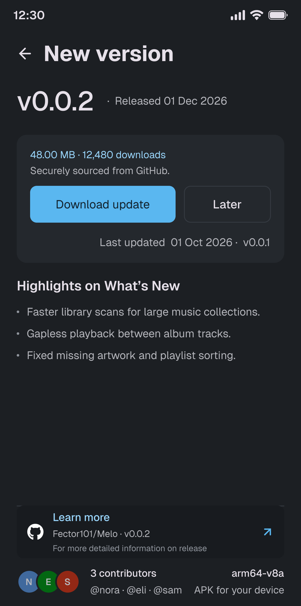
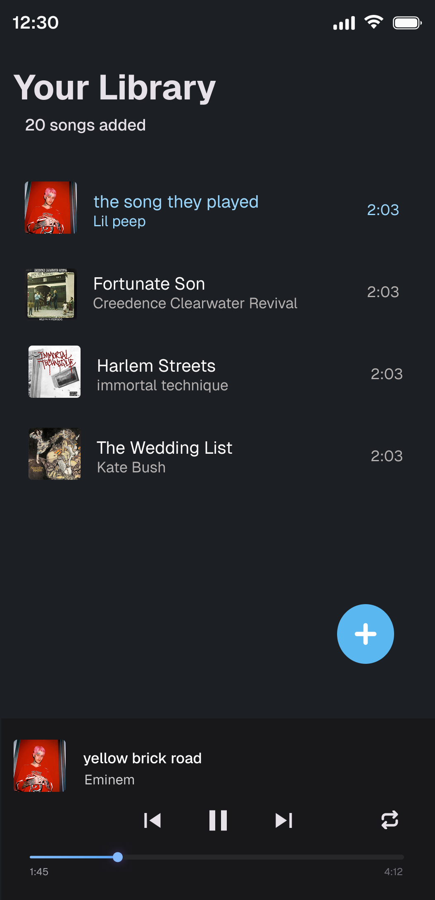

# Melo
**A fast, lightweight music player for Android, built with Python.**

**[Download APK](https://github.com/Fector101/Melo/releases/latest/download/melo-v0.0.1-universal.apk)**

---

## Features

- Plays music in the background and provides a **notification** to control the music.
- Provides a list of all the music files in your device in about a **second**.
- Provides a simple yet **beautiful UI** to play music.
- **In-App updates** to easily keep the app up to date.

## Permissions
Requires only Audio and Notification to scan for music and display notification.
- `READ_MEDIA_AUDIO` or `READ_EXTERNAL_STORAGE` on Android 12 and below
- `POST_NOTIFICATIONS`

## Community
> [!NOTE]
> Melo is still in it's early stages and may have bugs.  
> If you find any, please report them in the [issues](https://github.com/Fector101/Melo/issues) section or create a [pull request](https://github.com/Fector101/Melo/pulls), to help improve the app.

## UI Sample:

| | |
| --- | --- |
|  |  |
